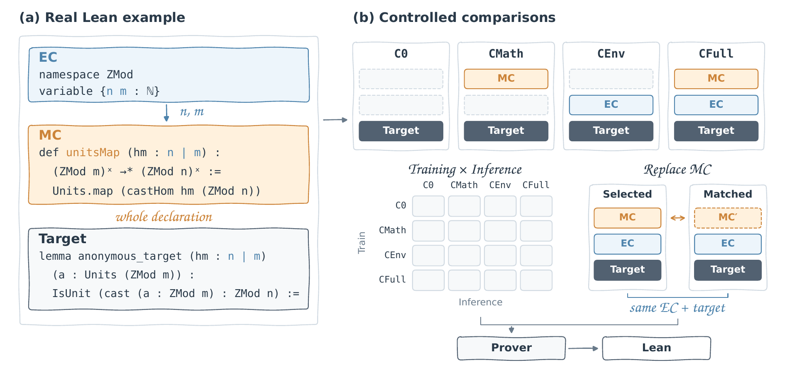

# LeanContext

**LeanContext: Disentangling Mathematical Resources from Local Formal Context in Lean Whole-Proof Generation**

Companion framework for studying how mathematical declarations and local source
commands affect Lean whole-proof generation. The code covers context extraction,
aligned data preparation, LLaDA and Llama-3.1 training, Lean verification, and
controlled context comparisons.



## Context views

**Mathematical Context (MC)** contains selected complete preceding mathematical
declarations. **Environment Context (EC)** contains the remaining selected local
source commands, such as namespaces, variables, and notation.

| View | Mathematical context | Environment context |
| --- | --- | --- |
| `C0` | — | — |
| `CMath` | MC | — |
| `CEnv` | — | EC |
| `CFull` | MC | EC |

All four views share the same proof target. Context commands retain source order,
and generated proofs are checked at the original target location in its complete
Lean environment. The framework supports crossed training/inference views,
matched declaration replacement with EC fixed, and dependency-aware selection.

## Repository layout

```text
extraction/             Lean command parsing and context selection
dataset_preparation/    Four-view export, tokenization, and controlled inputs
lean_proof_training/    LLaDA/Llama-3.1 training and whole-proof evaluation
analysis/               Context effects and representation analysis
semantic_audit/         Lean dependencies and declaration ownership
protocol.py             Shared prompt, token-budget, and proof-extraction rules
experiments.json        Training and evaluation configuration index
```

## Setup and a CPU self-test

Use Python 3.10 or newer. From the repository root, the protocol self-test runs
with the Python standard library:

```bash
python3 protocol.py --self-test
```

Keep tokenization, LLaDA, and Llama-3.1 in separate Python environments; their
dependency files pin different Transformers versions. Training and generation
require a suitable GPU environment and the corresponding pretrained model.

## Prepare data

Supply the dataset and tokenizer files separately from this source repository.
The runtime preparation entry point expects the following input layout:

```text
leancontext_dataset/
  dataset.complete.with_four_views.json
  command_mapping/source_commands/   # or source_commands.jsonl
  selector/pairs.jsonl
  selector/frozen_test_manifest.json
  source_snapshot/
  tokenizers/
    llada/{tokenizer.json,tokenizer_config.json,...}
    llama31/{tokenizer.json,tokenizer_config.json,...}
```

Use the matching tokenizer revisions specified by the model configurations.
Additional analysis subsets and dependency records are used by the corresponding
optional analysis and intervention tools.

In a tokenization environment, run from the repository root. Replace the paths
below with local absolute paths; `DATASET_ROOT` must be a new output directory.

```bash
export DATASET_RELEASE_ROOT=/path/to/leancontext_dataset
export DATASET_ROOT=/path/to/leancontext_runtime
export CHECKPOINT_ROOT=/path/to/checkpoints
export MODEL_CACHE=/path/to/model_cache
export EVAL_ROOT=/path/to/evaluation
export MATHLIB_ROOT=/path/to/mathlib4-4.14.0-rc1
export NUM_GPUS=16

python3 -m pip install -r requirements-tokenize.txt
python3 -m dataset_preparation.prepare_runtime \
  --dataset-root "$DATASET_RELEASE_ROOT" --output-root "$DATASET_ROOT" \
  --models llada llama31 --execute
```

Preparation exports the saved four views and builds model-specific token caches.
Prompts use at most 1,024 tokens; a complete proof plus one EOS has a separate
1,024-token limit. Context clipping removes whole commands, and partial views
are projected from the same full context without refilling. Statement and proof
text are not truncated.

## Train and evaluate

From `lean_proof_training/`, use the following commands in **separate model
environments**, with the environment variables above available in each shell.

```bash
# LLaDA environment
python3 -m pip install -r requirements-dllm.txt
bash scripts/train.sh dllm configs/llada/full_sft_CFull.yaml
bash scripts/evaluate.sh llada CFull
```

```bash
# Llama-3.1 environment
python3 -m pip install -r requirements-llama31.txt
bash scripts/train.sh llama31 configs/llama31/full_sft_CFull.yaml
bash scripts/evaluate.sh llama31 CFull
```

Substitute `C0`, `CMath`, or `CEnv` for other views. Configuration files specify
model revisions, data paths, optimization, and decoding. The training launcher
uses distributed data parallelism; `NUM_GPUS` must be a positive divisor of 32.
Choose hardware that fits the configured model and optimizer state.

Lean verification requires **Lean `4.14.0-rc1` and Mathlib `v4.14.0-rc1`**, pinned
to Mathlib commit `a7fc949f1b05c2a01e01c027fd9f480496a1253e`.
See [extraction setup](extraction/USAGE.txt) for installation and environment
checks. Evaluation saves generated proofs, Lean diagnostics, and per-target
metrics; `sorry`, `admit`, and unresolved goals are rejected.

## Further documentation

- [Extraction and context selection](extraction/USAGE.txt)
- [Matched mathematical-context replacement](dataset_preparation/README_MATCHED_REPLACEMENT.md)
- [Proof-blind context reconstruction](dataset_preparation/README_PROOF_BLIND_RECONSTRUCTION.md)
- [Context effects and representation analysis](analysis/README.md)
- [Lean dependency and ownership tools](semantic_audit/README.md)
- [Runnable configuration index](experiments.json)

## License

This project is released under the [MIT License](LICENSE). See
[third-party notices](THIRD_PARTY_NOTICES.md) for bundled components. Datasets,
pretrained models, and tokenizers retain their respective providers' licenses.
